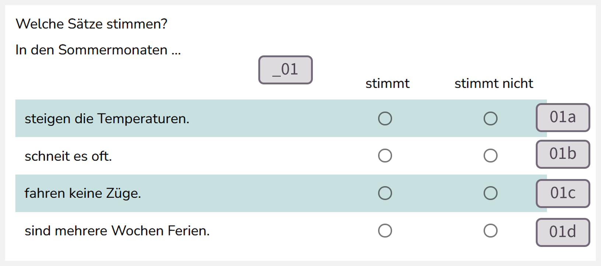
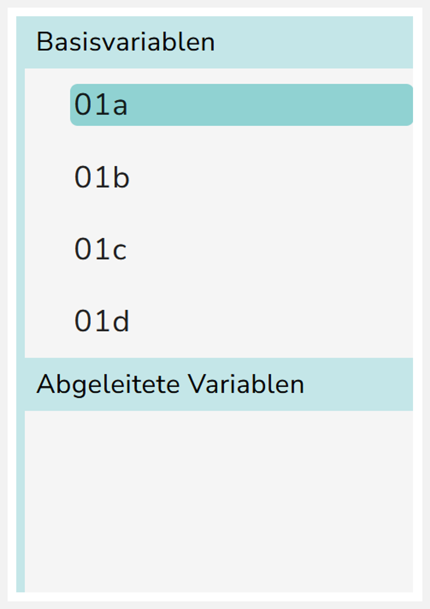
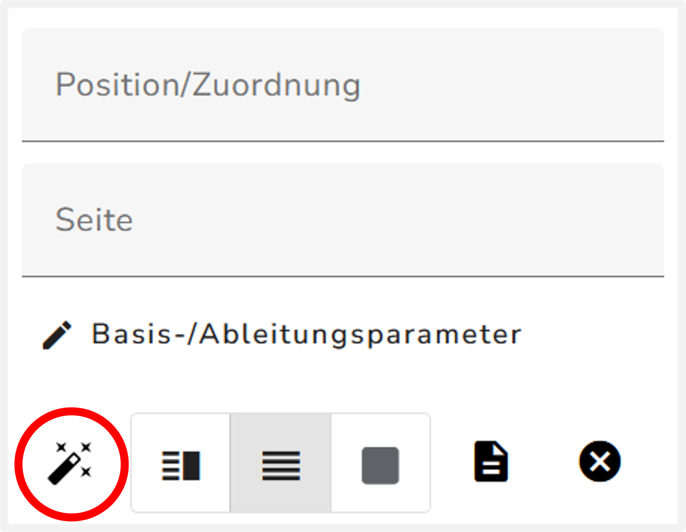
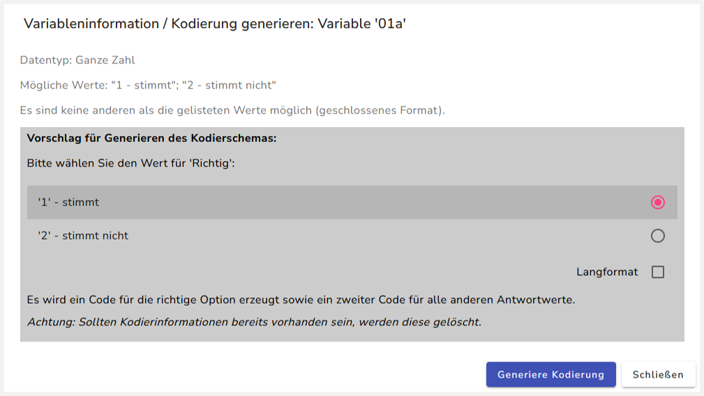
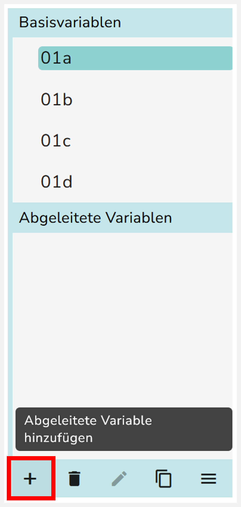
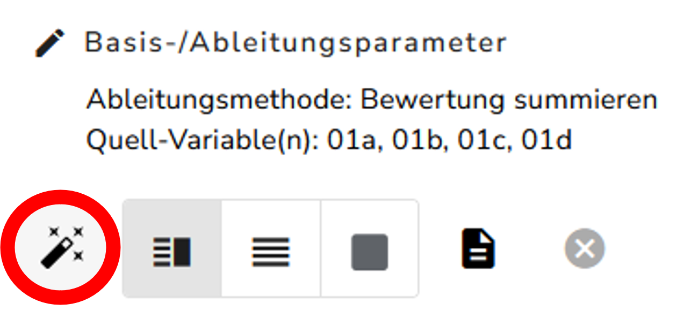
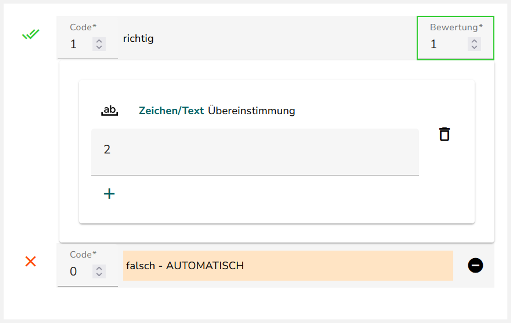
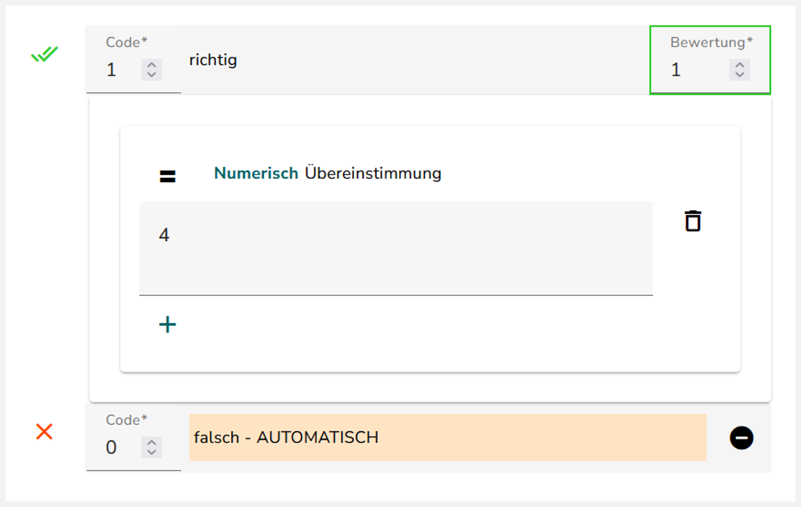

<!-- {width="498"}
-->

## Benennung der Basisvariablen

::: {layout="[ [40,60] ]"}
Prüfen Sie zunächst, ob die Basisvariablen der CMC-Aufgabe die richtigen IDs haben. Eine Basisvariable entspricht einer Zeile in der CMC-Tabelle. Wie genau die Umbenennung erfolgt wird [hier](IDs%20im%20Studio%20umbenennen%20–%20Optionentabelle%20(CMC)) erklärt. Zur Übersicht sehen Sie in der Abbildung rechts, wie das Schema für die Benennung einer CMC-Aufgabe aussieht.

:::

# Variante A

## Kodierschema der Basisvariablen

::: {.panel-tabset}

## Kodierungs-Assistent {width="24"} 

::: {layout="[[1]]"}
### Schritt 1: Kodierschema generieren 

Im ersten Schritt geben Sie für jede Basisvariable (Zeile der CMC-Tabelle) die richtige Antwortoption an. Gehen Sie dazu mit jeder Basisvariable wie folgt vor:
:::

::: {layout="[[2,1]]"}
1.  Wählen Sie eine Basisvariable aus.

{fig-align="center"}
:::

::: {layout="[[1,1]]"}
2.  Klicken Sie auf das Zauberstab-Symbol {width="24"}. Es sollte sich ein neues Fenster öffnen.

{fig-align="right"}
:::

::: {layout="[[1]]"}
3.  Geben Sie in dem Fenster die richtige Antwortoption für die entsprechende Zeile der CMC-Tabelle an. \n 4. Klicken Sie auf „Generiere Kodierung“

{fig-align="center"}
:::

Wiederholen Sie die Schritte mit jeder Basisvariable der CMC-Tabelle.

## Manuelle Erstellung

Hier kommt eine Anleitung zum manuellen Anlegen des Kodierschemas. 

:::

# Variante B

::: {.panel-tabset}

## Kodierungs-Assistent {width="24"} 

:::::: columns
::: column
**1.**  Wählen Sie eine Basisvariable aus.

{width="50%" fig-align="center"}
:::

::: column
**2.**  Klicken Sie auf das Zauberstab-Symbol {width="24"}. Es sollte sich ein neues Fenster öffnen.

{width="70%" fig-align="center"}
:::
::::::

**3.**  Geben Sie in dem Fenster die richtige Antwortoption für die entsprechende Zeile der CMC-Tabelle an. 

**4.** Klicken Sie auf „Generiere Kodierung“

{width="95%" fig-align="center"}

Wiederholen Sie die Schritte mit jeder Basisvariable der CMC-Tabelle.

## Manuelle Erstellung

Hier kommt eine Anleitung zum manuellen Anlegen des Kodierschemas. 

:::

## Kodierschema der abgeleiteten Variable erstellen

Mit der abgeleiteten Variable wird geprüft, ob die Summe der Bewertungen über alle Zeilen der Tabelle mit dem eingetragenen Wert übereinstimmt. Das hier beschriebene Kodierschema der abgeleiteten Variable vergibt eine Bewertung mit einem Punkt, wenn alle Zeilen der Tabelle richtig beantwortet wurden. Andernfalls wird die CMC-Tabelle mit 0 Punkten bewertet.

::: {.panel-tabset}

## Kodierungs-Assistent {width="24"} 

### Schritt 1: Erstellen Sie die abgeleitete Variable

:::::: columns
::: column
1.  Klicken Sie dazu auf das Plus-Symbol "Abgeleitete Variable hinzufügen". Es öffnet sich ein Menü, um die abgeleitete Variable zu erstellen.
:::

::: column
{width="60%" fig-align="center"}
:::
::::::

::: {layout="[[1,1]]"}
2.  Nehmen Sie in dem Menü folgende Einstellungen für die abgeleitete Variable vor:
    - Name: Die Variable erhält als Namen die übergeordnete ID zu den Zeilen der Tabelle (d.h. ID `03`, falls die Basisvariablen nach dem Schema `03a`, `03b`, … benannt sind).
    - Wählen Sie als Quellvariablen alle Basisvariablen aus, die eine Zeile der CMC-Tabelle kodieren.
    - Ableitungsmethode: „Bewertungen summieren“

{width="95%" fig-align="center"}
:::

### Schritt 2: Kodierschema generieren 

::: {layout="[[2,1]]"}
1. Klicken Sie auf das Zauberstab-Symbol {width="24"}. Es öffent sich ein neues Fenster.

{fig-align="center"}
:::

2. Tragen Sie in dem Fenster unter „Übereinstimmung“ die Anzahl an Zeilen ein, die die CMC-Tabelle hat. 

3. Klicken Sie auf „Generiere Kodierung“.

{width="95%" fig-align="center"}

## Manuelle Erstellung

Hier kommt eine Anleitung zum manuellen Anlegen des Kodierschemas. 

:::

Das erstellte Kodierschema sollte ungefähr so aussehen:

::: panel-tabset
## Basisvariablen

Kodierung jeder Basisvariable

## Abgeleitete Variable

Kodierung der abgeleiteten Variable

:::