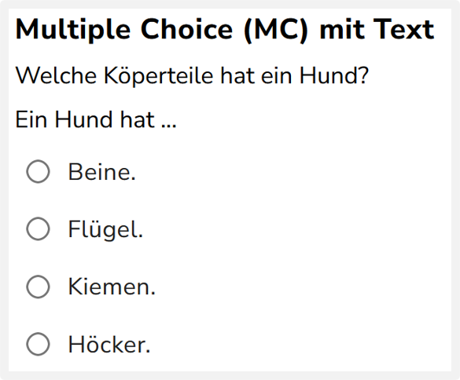
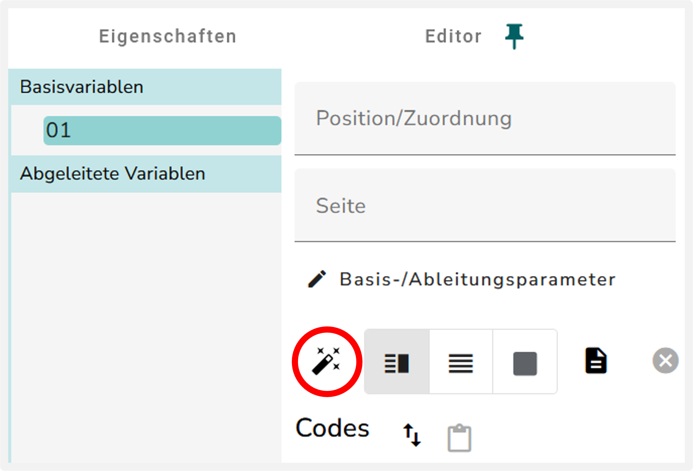
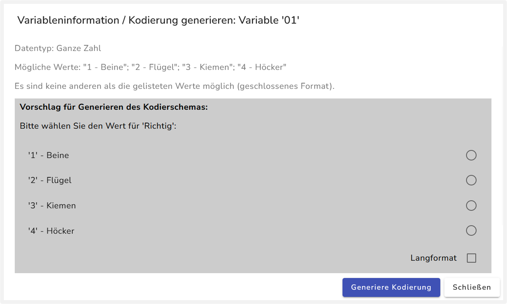
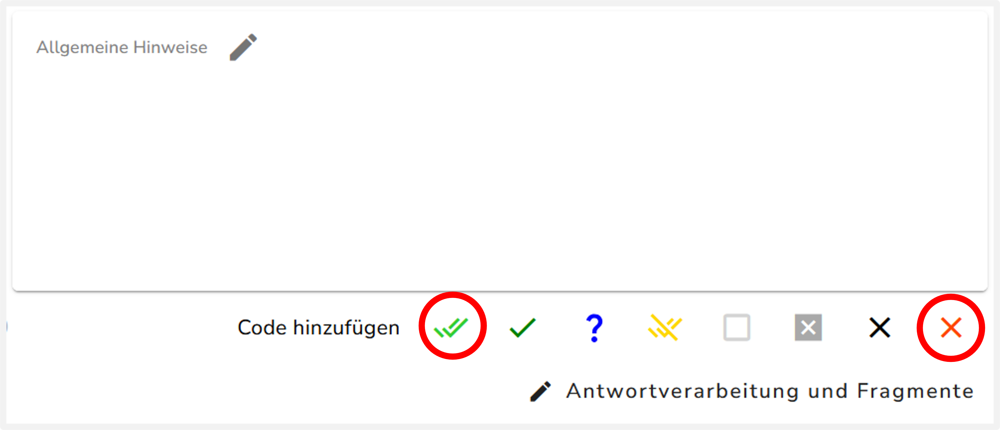
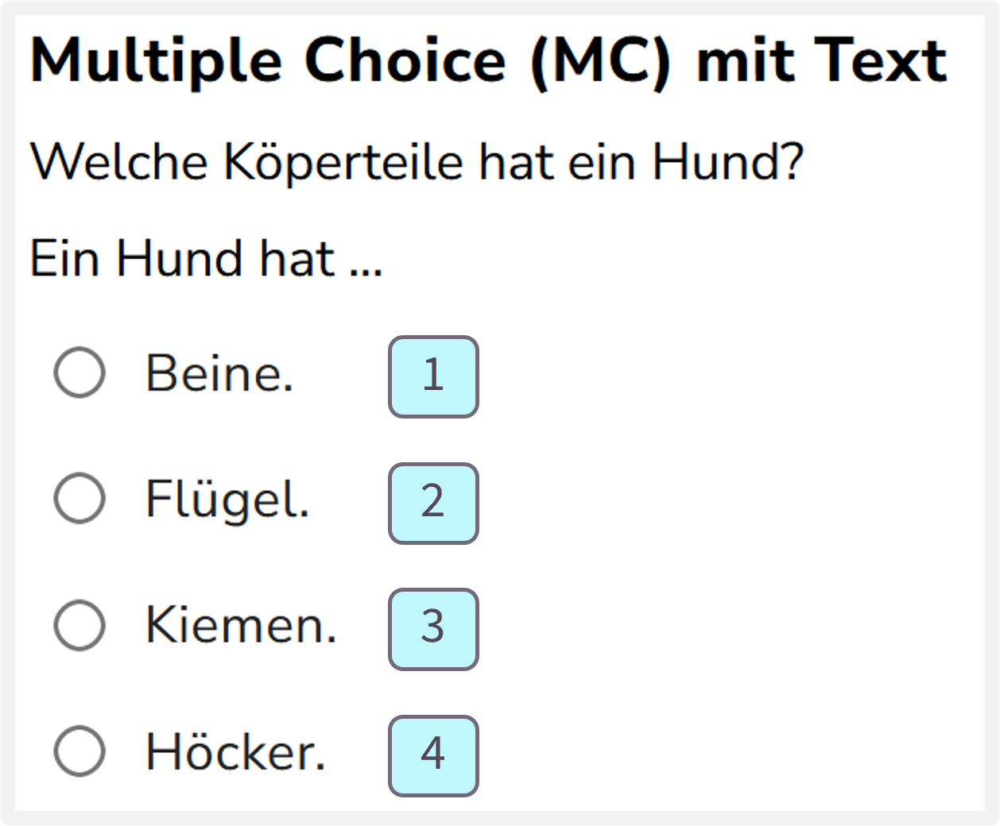

{width="30%" fig-align="left"}

## Umbenennung des Interaktionselements „Optionsfeld“

Prüfen Sie zunächst, ob für das MC-Element (Optionsfeld) die richtige ID vergeben wurde. Die Umbenennung wird im Abschnitt @sec-umbenennung erklärt.

## Kodierschema der Basisvariable anlegen

Das Kodierschema für MC-Aufgaben kann auf zwei Weisen angelegt werden, die beide das gleiche Ergebnis liefern. Zum einen über den Kodierungs-Assistenten {width="24"}, der das Kodierschema automatisch anlegt. Das ist die einfachere Variante und wird empfohlen. Alternativ können Sie das Kodierschema auch manuell anlegen.

Klicken Sie auf die Überschrift "Manuelle Kodierung", wenn Sie die alternative Anleitung zum Anlegen des Kodierschemas lesen möchten.

::: {.panel-tabset}
## Kodierungs-Assistent {width="24"}

1. Klicken Sie auf das Zauberstab-Symbol {width="24"}

{width="65%" fig-align="center"}

2. Wählen Sie in dem neuen Fenster die richtige Antwortoption für die Frage aus. 

{width="95%" fig-align="center"}

3. Klicken Sie auf „Generiere Kodierung“. Dadurch wird das Kodierschema automatisch erstellt.

## Manuelle Kodierung

1. Fügen Sie einen "Richtig-Code" {width="24"} hinzu.

2. Fügen Sie einen Falsch-Code {width="24"} hinzu ("Falsch: Alle anderen Antworten - AUTOMATISCH").

{width="85%" fig-align="center"}

::: {layout="[[2,1]]"}
3. Geben Sie in dem Richtig-Code in das Feld unter "Zeichen/Text Übereinstimmung" die Ziffer der richtigen Antwortoption an. Die Antwortoptionen sind von oben nach unten durchnummeriert, beginnend mit `1`, `2`, ... .

{width="45%" fig-align="center"}

:::
 
:::

::: {.panel-tabset}

## Kodierschema Basisvariable

Das erzeugte Kodierschema sollte ungefähr so aussehen:

{width="506"}

:::

