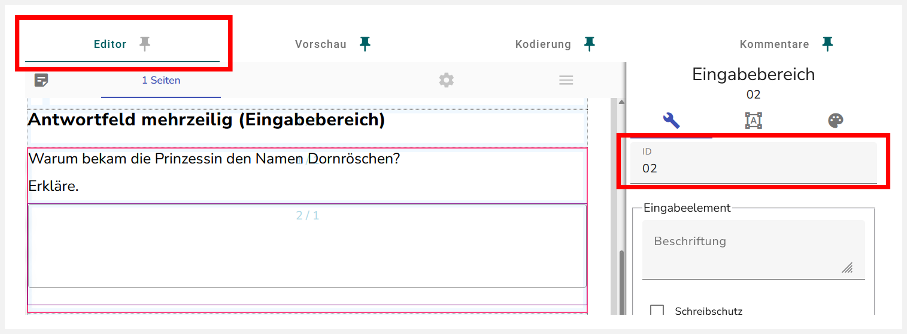
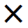
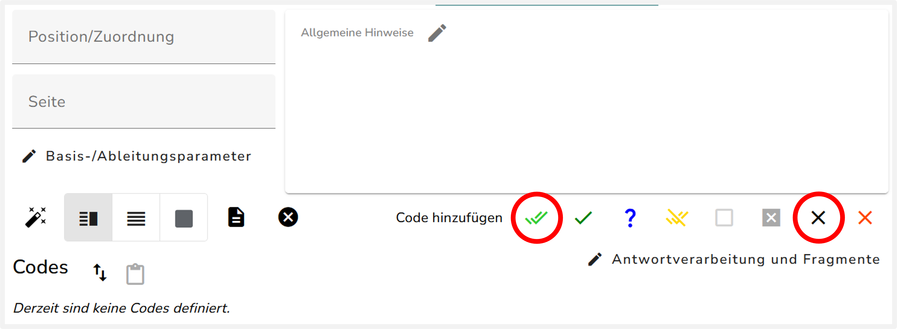
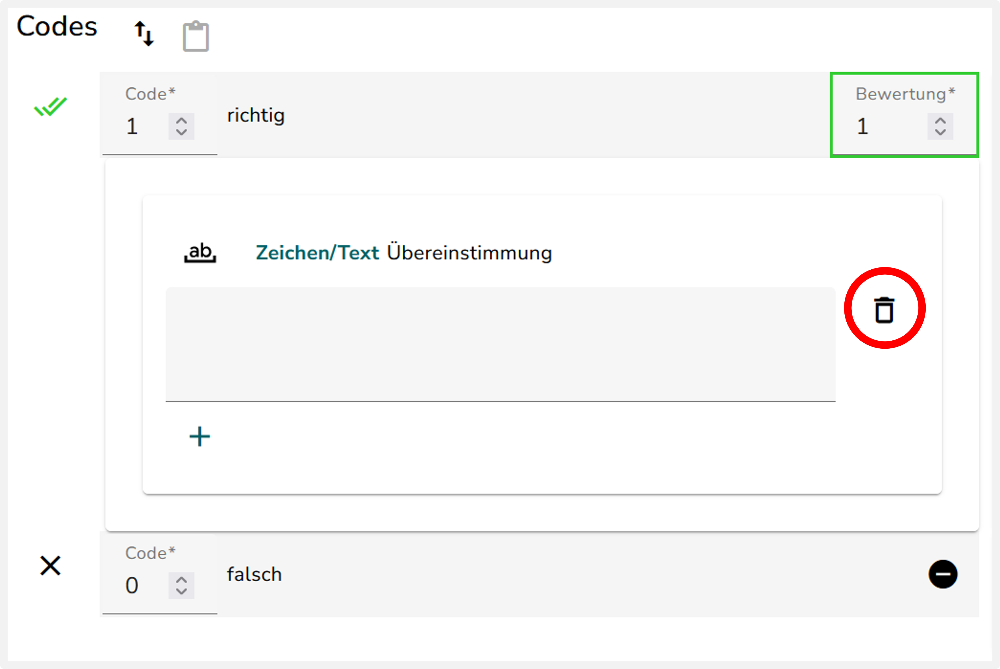
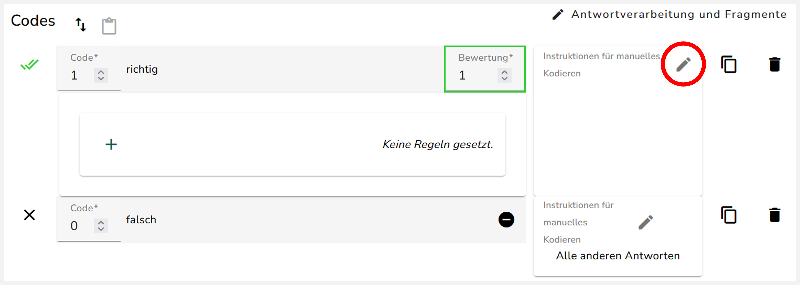
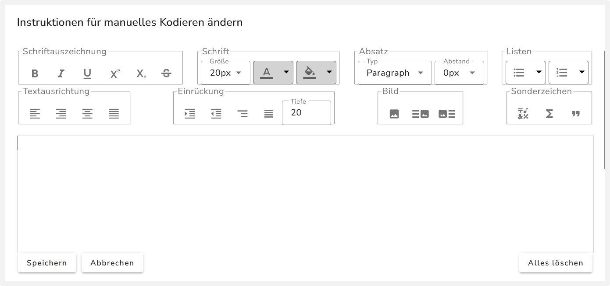
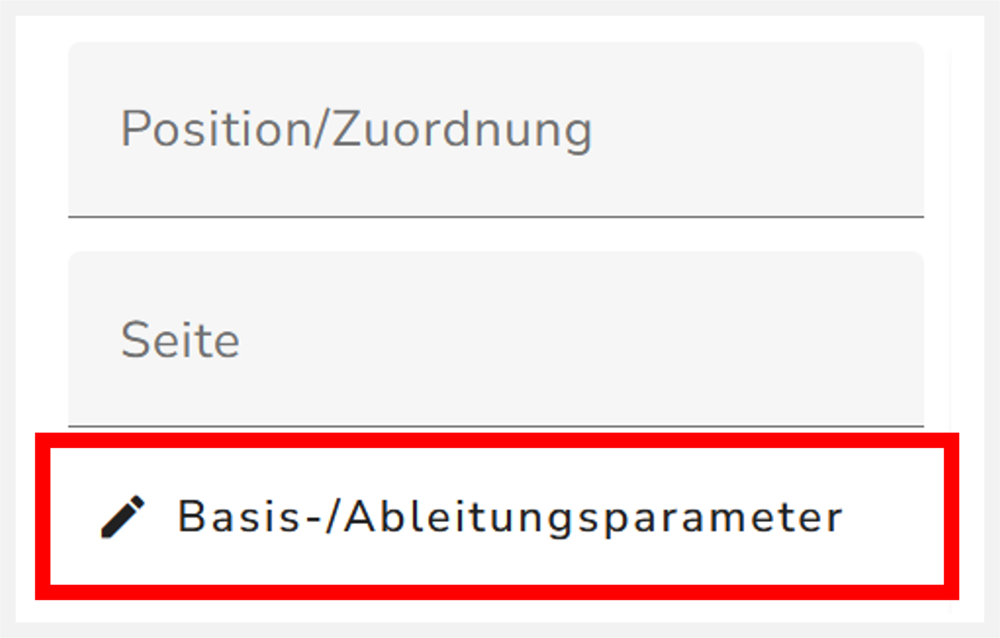
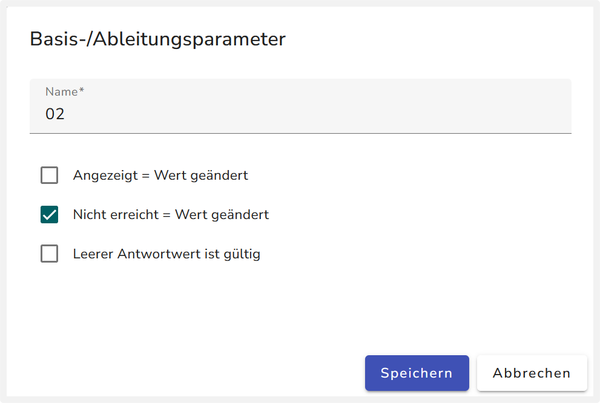
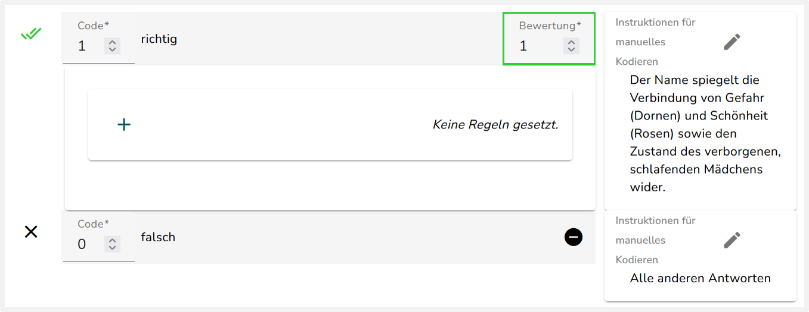

{width="60%"}

Dieses Aufgabenformat besteht aus einer offen gestelten Textaufgabe, sodass es viele Antwortmöglichkeiten gibt. Dadurch ist eine automatisierte Kodierung nicht möglich und die Aufgabe muss später manuell kodiert werden. Durch Einfügen eines bestimmten Falsch-Codes in das Kodierschema wird die Aufgabe zur manuellen Kodierung zugewiesen. Zudem werden die Instruktionen für die manuelle Kodierung eingefügt.

## Benennung des Textfelds

Bei Textaufgaben wird das Kodierschema für das Textfeld der Aufgabe angelegt. Das Textfeld erhält eine ID nach dem Schema `01`, `02`, ... . Passen Sie die ID des Textfelds der Aufgabe wie folgt an:

1. Gehen Sie zurück in den **Editor** des IQB-Studios.

2. Klicken Sie auf das Textfeld der Aufgabe, die sie umbenennen wollen. Das Textfeld sieht aus wie eine leeres Rechteck. Wenn Sie auf das Textfeld geklickt haben, sollte im Menü am rechten Rand "Eingabefeld" oder "Eingabebereich" stehen. So wird das Textfeld im IQB-Studio genannt. 

3. Geben Sie nun in dem Feld "ID" eine neue ID nach dem Schema `01`, `02`, ... ein. Die Nummerierung sollte sich über Aufgaben hinweg fortsetzen. Falls Sie mehrere Textfelder in einer Textaufgabe haben, können Sie auch IDs nach dem Schema `01a`, `01b`, `01c`, ... vergeben. Wobei statt `01` die fortlaufende Aufgaben-ID verwendet werden sollte.

## Kodierschema anlegen

1.  Richtig Code {width="24"} ohne Regeln hinzufügen: 
Fügen Sie einen Richtig-Code {width="24"} hinzu.

2.  Falsch Code hinzufügen: 
Fügen Sie den Falsch-Code {width="24"} „Falsch: Alle anderen Antworten“ hinzu. Dadurch wird die Aufgabe zur manuellen Korrektur weitergeleitet.

3. Löschen Sie die Regel aus dem Richtig-Code {width="24"}. Dort steht dann „Keine Regel gesetzt“.

4.  Instruktionen hinzufügen:
Fügen Sie die Instruktionen für richtige und falsche Antworten hinzu. Wie das geht, wird [hier](../../Allgemein/instruktionen.qmd) beschrieben.

::: {layout="[[2,1]]"}

:::

5. Parameter setzen:

::: {layout="[[-2,49,49]]"}
1. Klicken Sie auf "Basis/Ableitungsparameter". Es erscheint ein neues Menüfenster.

:::

::: {layout="[[-2,49,49]]"}
2. Wählen Sie in dem Menüfenster "Nicht erreicht = Wert geändert" aus. 

:::

::: {.panel-tabset}

## Kodierschema

Das erzeugte Kodierschema sollte in etwa so aussehen:

:::

