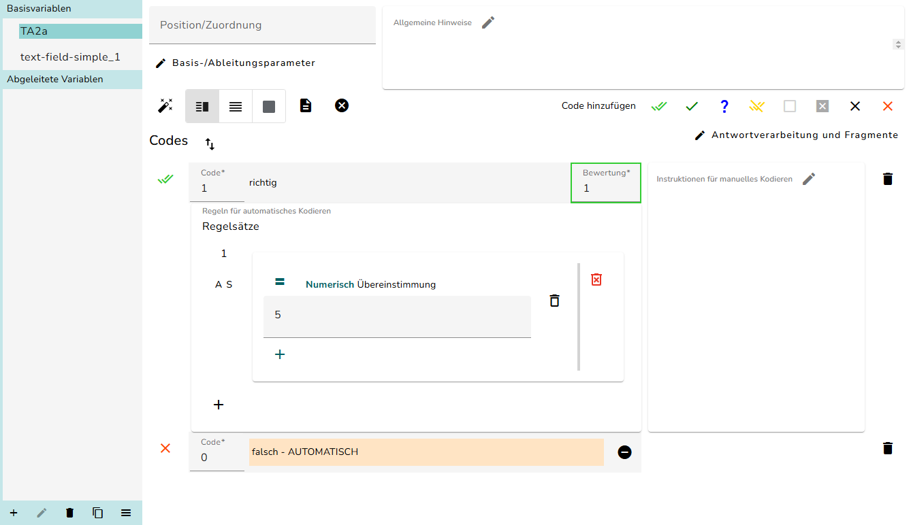

# Kodierschema

Bei der Aufgabenerstellung im Studio werden Frageelemente in einer Unit angeordnet. Die Beantwortung dieser Frageelemente erzeugt Antwortwerte. Um Schlussfolgerungen hinsichtlich der Bewertung einer Antwort zu ziehen, werden die Antwortwerte Kategorien zugeordnet. Im einfachsten Fall gibt es die Kategorien richtig und falsch, sowie Kategorien für fehlende Werte. Die Zuordnung erfolgt durch die Erstellung von Regeln und Instruktionen. Diese sagen dann ganz grob ausgedrückt, diese Antwort ist falsch, und diese Antwort ist richtig.

- Die Zuordnung einer Antwort zu einer Kategorie nennen wir **Kodierung**. Man vergibt für eine Antwort einen Code.
- Wir unterscheiden **Regeln** für die automatische Kodierung und **Instruktionen** für die manuelle Kodierung.
- Die Gesamtheit der Regeln und Instruktionen zur Kodierung der Antworten einer Aufgabe nennen wir **Kodierschema**.
- Den Teil der Studioprogrammierung, mit dem wir das Kodierschema definieren, nennen wir **Schemer**. Es handelt sich um ein austauschbares Verona-Modul wie der Player und der Editor.

Dieser Abschnitt thematisiert die Definition eines Kodierschemas als Teil der Aufgabenentwicklung.

> **NOTE:**
>
> Das Kodierschema ist grundsätzlich sehr offen und flexibel. Für eine effiziente Kodierung und Datenauswertung hat das IQB jedoch zahlreiche Konventionen und Vorgehensweisen eingeführt, die in diesem Abschnitt als notwendig beschrieben sind.

Lesen Sie weiter:

- [Elemente und Variablen](../../tasks/coding-scheme/steps.llms.md)
- [Basisfälle](../../tasks/coding-scheme/basic.llms.md)
- [Sonderfälle](../../tasks/coding-scheme/extended.llms.md)

Gesamtansicht Schemer

- Im **linken Bildschirmbereich** finden Sie eine Liste aller Variablen und Schalter für übergreifende Funktionen.
  - Oben in der Liste finden sich die Basisvariablen. Diese stehen für Datenquellen, die in der Aufgabendefinition angelegt wurden (z. B. Eingabefeld, Checkbox usw.).
  - Weiter unten sind die abgeleiteten Variablen gelistet. Diese beziehen ihren Wert und dann ihre Kodierung aus einer oder mehreren anderen Variablen.
  - Über Schalter unten links können Variablen angelegt, gelöscht, umbenannt, kopiert oder geprüft werden.
- Im **rechten Bildschirmbereich** sind die Regeln und Instruktionen für die jeweils gewählte Variable zu sehen.

Die folgende Darstellung zeigt die allgemeine Arbeitsweise bei der Definition eines Kodierschemas. Die einzelnen Punkte sind dann in separaten Texten dieses Abschnittes beschrieben.

![](data:image/svg+xml;base64,PHN2ZyB3aWR0aD0iNjcyIiBoZWlnaHQ9IjQ4MCIgdmlld2JveD0iMC4wMCAwLjAwIDYzMi4yMyAxNjEuMDAiIHhtbG5zPSJodHRwOi8vd3d3LnczLm9yZy8yMDAwL3N2ZyIgeGxpbms9Imh0dHA6Ly93d3cudzMub3JnLzE5OTkveGxpbmsiIHN0eWxlPSI7IG1heC13aWR0aDogbm9uZTsgbWF4LWhlaWdodDogbm9uZSI+CjxnIGlkPSJncmFwaDAiIGNsYXNzPSJncmFwaCIgdHJhbnNmb3JtPSJzY2FsZSgxIDEpIHJvdGF0ZSgwKSB0cmFuc2xhdGUoNCAxNTcpIj4KPHRpdGxlPkc8L3RpdGxlPgo8cG9seWdvbiBmaWxsPSJ3aGl0ZSIgc3Ryb2tlPSJ0cmFuc3BhcmVudCIgcG9pbnRzPSItNCw0IC00LC0xNTcgNjI4LjIzLC0xNTcgNjI4LjIzLDQgLTQsNCI+PC9wb2x5Z29uPgo8ZyBpZD0iY2x1c3QxIiBjbGFzcz0iY2x1c3RlciI+Cjx0aXRsZT5jbHVzdGVyXzA8L3RpdGxlPgo8cG9seWdvbiBmaWxsPSJsaWdodGJsdWUiIHN0cm9rZT0ibGlnaHRibHVlIiBwb2ludHM9IjgsLTggOCwtMTQ1IDE4Ny4wNiwtMTQ1IDE4Ny4wNiwtOCA4LC04Ij48L3BvbHlnb24+Cjx0ZXh0IHRleHQtYW5jaG9yPSJtaWRkbGUiIHg9Ijk3LjUzIiB5PSItMTI4LjQiIGZvbnQtZmFtaWx5PSJBcmlhbCIgZm9udC1zaXplPSIxNC4wMCI+RWlnZW5zY2hhZnRlbjwvdGV4dD4KPC9nPgo8ZyBpZD0iY2x1c3QyIiBjbGFzcz0iY2x1c3RlciI+Cjx0aXRsZT5jbHVzdGVyXzE8L3RpdGxlPgo8cG9seWdvbiBmaWxsPSJsaWdodGJsdWUiIHN0cm9rZT0ibGlnaHRibHVlIiBwb2ludHM9IjIwNy4wNiwtNjAgMjA3LjA2LC0xNDMgMzQ2LjQ2LC0xNDMgMzQ2LjQ2LC02MCAyMDcuMDYsLTYwIj48L3BvbHlnb24+Cjx0ZXh0IHRleHQtYW5jaG9yPSJtaWRkbGUiIHg9IjI3Ni43NiIgeT0iLTEyNi40IiBmb250LWZhbWlseT0iQXJpYWwiIGZvbnQtc2l6ZT0iMTQuMDAiPkVkaXRvcjwvdGV4dD4KPC9nPgo8ZyBpZD0iY2x1c3QzIiBjbGFzcz0iY2x1c3RlciI+Cjx0aXRsZT5jbHVzdGVyXzI8L3RpdGxlPgo8cG9seWdvbiBmaWxsPSJsaWdodGJsdWUiIHN0cm9rZT0ibGlnaHRibHVlIiBwb2ludHM9IjM2Ni40NiwtMzQgMzY2LjQ2LC0xMTcgNTAwLjQxLC0xMTcgNTAwLjQxLC0zNCAzNjYuNDYsLTM0Ij48L3BvbHlnb24+Cjx0ZXh0IHRleHQtYW5jaG9yPSJtaWRkbGUiIHg9IjQzMy40MyIgeT0iLTEwMC40IiBmb250LWZhbWlseT0iQXJpYWwiIGZvbnQtc2l6ZT0iMTQuMDAiPktvZGllcnVuZzwvdGV4dD4KPC9nPgo8ZyBpZD0iY2x1c3Q0IiBjbGFzcz0iY2x1c3RlciI+Cjx0aXRsZT5jbHVzdGVyXzM8L3RpdGxlPgo8cG9seWdvbiBmaWxsPSJsaWdodGJsdWUiIHN0cm9rZT0ibGlnaHRibHVlIiBwb2ludHM9IjUyMC40MSwtMzQgNTIwLjQxLC0xMTcgNjE2LjIzLC0xMTcgNjE2LjIzLC0zNCA1MjAuNDEsLTM0Ij48L3BvbHlnb24+Cjx0ZXh0IHRleHQtYW5jaG9yPSJtaWRkbGUiIHg9IjU2OC4zMiIgeT0iLTEwMC40IiBmb250LWZhbWlseT0iQXJpYWwiIGZvbnQtc2l6ZT0iMTQuMDAiPlZvcnNjaGF1PC90ZXh0Pgo8L2c+CjwhLS0gbSAtLT4KPGcgaWQ9Im5vZGUxIiBjbGFzcz0ibm9kZSI+Cjx0aXRsZT5tPC90aXRsZT4KPHBvbHlnb24gZmlsbD0id2hpdGUiIHN0cm9rZT0id2hpdGUiIHBvaW50cz0iMTY5LjkyLC0xMTEuNiAyNS4xNCwtMTExLjYgMjUuMTQsLTcwLjQgMTY5LjkyLC03MC40IDE2OS45MiwtMTExLjYiPjwvcG9seWdvbj4KPHRleHQgdGV4dC1hbmNob3I9Im1pZGRsZSIgeD0iOTcuNTMiIHk9Ii05NS4yIiBmb250LWZhbWlseT0iQXJpYWwiIGZvbnQtc2l6ZT0iMTQuMDAiPlByw7xmZW48L3RleHQ+Cjx0ZXh0IHRleHQtYW5jaG9yPSJtaWRkbGUiIHg9Ijk3LjUzIiB5PSItNzguNCIgZm9udC1mYW1pbHk9IkFyaWFsIiBmb250LXNpemU9IjE0LjAwIj5TY2hlbWVyLVp1d2Vpc3VuZzwvdGV4dD4KPC9nPgo8IS0tIHAgLS0+CjxnIGlkPSJub2RlMyIgY2xhc3M9Im5vZGUiPgo8dGl0bGU+cDwvdGl0bGU+Cjxwb2x5Z29uIGZpbGw9IndoaXRlIiBzdHJva2U9IndoaXRlIiBwb2ludHM9IjMzOC42NiwtMTA5LjYgMjE0Ljg2LC0xMDkuNiAyMTQuODYsLTY4LjQgMzM4LjY2LC02OC40IDMzOC42NiwtMTA5LjYiPjwvcG9seWdvbj4KPHRleHQgdGV4dC1hbmNob3I9Im1pZGRsZSIgeD0iMjc2Ljc2IiB5PSItOTMuMiIgZm9udC1mYW1pbHk9IkFyaWFsIiBmb250LXNpemU9IjE0LjAwIj5QcsO8ZmVuL0FucGFzc2VuPC90ZXh0Pgo8dGV4dCB0ZXh0LWFuY2hvcj0ibWlkZGxlIiB4PSIyNzYuNzYiIHk9Ii03Ni40IiBmb250LWZhbWlseT0iQXJpYWwiIGZvbnQtc2l6ZT0iMTQuMDAiPkVsZW1lbnRlLUlEPC90ZXh0Pgo8L2c+CjwhLS0gbSYjNDU7Jmd0O3AgLS0+CjxnIGlkPSJlZGdlMSIgY2xhc3M9ImVkZ2UiPgo8dGl0bGU+bS0mZ3Q7cDwvdGl0bGU+CjxwYXRoIGZpbGw9Im5vbmUiIHN0cm9rZT0iYmxhY2siIGQ9Ik0xNjkuODUsLTkwLjJDMTgxLjI3LC05MC4wNyAxOTMuMDgsLTg5LjkzIDIwNC40OSwtODkuOCIgLz4KPHBvbHlnb24gZmlsbD0iYmxhY2siIHN0cm9rZT0iYmxhY2siIHBvaW50cz0iMjA0Ljg4LC05My4zIDIxNC44NCwtODkuNjkgMjA0LjgsLTg2LjMgMjA0Ljg4LC05My4zIj48L3BvbHlnb24+CjwvZz4KPCEtLSBpIC0tPgo8ZyBpZD0ibm9kZTIiIGNsYXNzPSJub2RlIj4KPHRpdGxlPmk8L3RpdGxlPgo8cG9seWdvbiBmaWxsPSJ3aGl0ZSIgc3Ryb2tlPSJ3aGl0ZSIgcG9pbnRzPSIxNzkuMDksLTUyIDE1Ljk3LC01MiAxNS45NywtMTYgMTc5LjA5LC0xNiAxNzkuMDksLTUyIj48L3BvbHlnb24+Cjx0ZXh0IHRleHQtYW5jaG9yPSJtaWRkbGUiIHg9Ijk3LjUzIiB5PSItMjkuOCIgZm9udC1mYW1pbHk9IkFyaWFsIiBmb250LXNpemU9IjE0LjAwIj5adXdlaXNlbiBJdGVtLVZhcmlhYmxlPC90ZXh0Pgo8L2c+CjwhLS0gZSAtLT4KPGcgaWQ9Im5vZGU0IiBjbGFzcz0ibm9kZSI+Cjx0aXRsZT5lPC90aXRsZT4KPHBvbHlnb24gZmlsbD0id2hpdGUiIHN0cm9rZT0id2hpdGUiIHBvaW50cz0iNDkyLjM4LC04My42IDM3NC40OSwtODMuNiAzNzQuNDksLTQyLjQgNDkyLjM4LC00Mi40IDQ5Mi4zOCwtODMuNiI+PC9wb2x5Z29uPgo8dGV4dCB0ZXh0LWFuY2hvcj0ibWlkZGxlIiB4PSI0MzMuNDMiIHk9Ii02Ny4yIiBmb250LWZhbWlseT0iQXJpYWwiIGZvbnQtc2l6ZT0iMTQuMDAiPkVyc3RlbGxlbi/DhG5kZXJuPC90ZXh0Pgo8dGV4dCB0ZXh0LWFuY2hvcj0ibWlkZGxlIiB4PSI0MzMuNDMiIHk9Ii01MC40IiBmb250LWZhbWlseT0iQXJpYWwiIGZvbnQtc2l6ZT0iMTQuMDAiPktvZGllcnNjaGVtYTwvdGV4dD4KPC9nPgo8IS0tIHAmIzQ1OyZndDtlIC0tPgo8ZyBpZD0iZWRnZTIiIGNsYXNzPSJlZGdlIj4KPHRpdGxlPnAtJmd0O2U8L3RpdGxlPgo8cGF0aCBmaWxsPSJub25lIiBzdHJva2U9ImJsYWNrIiBkPSJNMzM4Ljg5LC03OC43MkMzNDcuMjcsLTc3LjMyIDM1NS45MSwtNzUuODYgMzY0LjQsLTc0LjQ0IiAvPgo8cG9seWdvbiBmaWxsPSJibGFjayIgc3Ryb2tlPSJibGFjayIgcG9pbnRzPSIzNjQuOTksLTc3Ljg5IDM3NC4yNywtNzIuNzggMzYzLjgzLC03MC45OCAzNjQuOTksLTc3Ljg5Ij48L3BvbHlnb24+CjwvZz4KPCEtLSBlJiM0NTsmZ3Q7aSAtLT4KPGcgaWQ9ImVkZ2U0IiBjbGFzcz0iZWRnZSI+Cjx0aXRsZT5lLSZndDtpPC90aXRsZT4KPHBhdGggZmlsbD0ibm9uZSIgc3Ryb2tlPSJibGFjayIgZD0iTTM3NC4zMiwtNTcuOTVDMzIzLjMzLC01My41MiAyNDguMzMsLTQ3LjAxIDE4OS40MiwtNDEuODkiIC8+Cjxwb2x5Z29uIGZpbGw9ImJsYWNrIiBzdHJva2U9ImJsYWNrIiBwb2ludHM9IjE4OS42MiwtMzguNCAxNzkuMzYsLTQxLjAyIDE4OS4wMiwtNDUuMzcgMTg5LjYyLC0zOC40Ij48L3BvbHlnb24+CjwvZz4KPCEtLSBrIC0tPgo8ZyBpZD0ibm9kZTUiIGNsYXNzPSJub2RlIj4KPHRpdGxlPms8L3RpdGxlPgo8cG9seWdvbiBmaWxsPSJ3aGl0ZSIgc3Ryb2tlPSJ3aGl0ZSIgcG9pbnRzPSI2MDguMTUsLTgzLjYgNTI4LjQ5LC04My42IDUyOC40OSwtNDIuNCA2MDguMTUsLTQyLjQgNjA4LjE1LC04My42Ij48L3BvbHlnb24+Cjx0ZXh0IHRleHQtYW5jaG9yPSJtaWRkbGUiIHg9IjU2OC4zMiIgeT0iLTY3LjIiIGZvbnQtZmFtaWx5PSJBcmlhbCIgZm9udC1zaXplPSIxNC4wMCI+UHLDvGZlbjwvdGV4dD4KPHRleHQgdGV4dC1hbmNob3I9Im1pZGRsZSIgeD0iNTY4LjMyIiB5PSItNTAuNCIgZm9udC1mYW1pbHk9IkFyaWFsIiBmb250LXNpemU9IjE0LjAwIj5Lb2RpZXJ1bmc8L3RleHQ+CjwvZz4KPCEtLSBlJiM0NTsmZ3Q7ayAtLT4KPGcgaWQ9ImVkZ2UzIiBjbGFzcz0iZWRnZSI+Cjx0aXRsZT5lLSZndDtrPC90aXRsZT4KPHBhdGggZmlsbD0ibm9uZSIgc3Ryb2tlPSJibGFjayIgZD0iTTQ5Mi43MiwtNjkuN0M1MDEuMTUsLTY5LjggNTA5Ljc2LC02OS43NSA1MTgsLTY5LjU1IiAvPgo8cG9seWdvbiBmaWxsPSJibGFjayIgc3Ryb2tlPSJibGFjayIgcG9pbnRzPSI1MTguMzEsLTczLjA0IDUyOC4xOSwtNjkuMjIgNTE4LjA4LC02Ni4wNCA1MTguMzEsLTczLjA0Ij48L3BvbHlnb24+CjwvZz4KPCEtLSBrJiM0NTsmZ3Q7ZSAtLT4KPGcgaWQ9ImVkZ2U1IiBjbGFzcz0iZWRnZSI+Cjx0aXRsZT5rLSZndDtlPC90aXRsZT4KPHBhdGggZmlsbD0ibm9uZSIgc3Ryb2tlPSJibGFjayIgZD0iTTUyOC4xOSwtNTYuNzhDNTIwLjIsLTU2LjQ1IDUxMS41NywtNTYuMjggNTAyLjg5LC01Ni4yNSIgLz4KPHBvbHlnb24gZmlsbD0iYmxhY2siIHN0cm9rZT0iYmxhY2siIHBvaW50cz0iNTAyLjcsLTUyLjc1IDQ5Mi43MiwtNTYuMyA1MDIuNzMsLTU5Ljc1IDUwMi43LC01Mi43NSI+PC9wb2x5Z29uPgo8L2c+CjwvZz4KPC9zdmc+)

Arbeitsablauf beim Bearbeiten des Kodierschemas

Zurück nach oben
