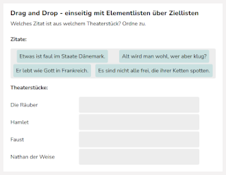
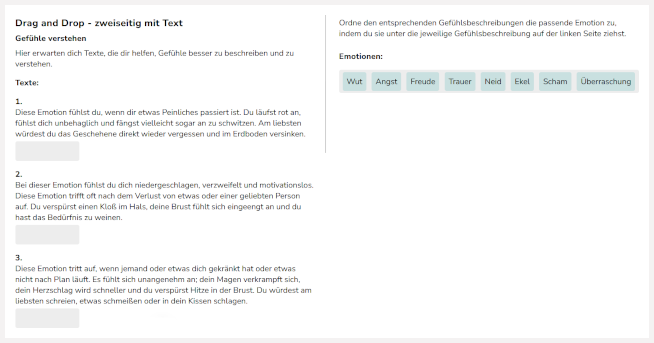
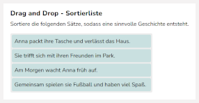

# Drag & Drop - Weiterleitung

# Assistent: Drag and Drop

Sie können aus verschiedenen Drag & Drop Formaten wählen. „Drag & Drop: Zuordnung“ hilft beim Erstellen von Drag and Drop Aufgaben mit textbasierten und/oder bildbasierten Antwortoptionen. „Drag & Drop – Sortieren“ ermöglicht das Erstellen einer Aufgabe, bei der Elemente in ihrer Reihenfolge verändert werden sollen.

## Zuordnung

Mit diesem Assistenten legen Sie eine einseitige Drag & Drop Aufgabe mit textbasierten und/oder bildbasierten Antwortoptionen an. Weitere Details dazu finden Sie hier: [Drag&Drop Zuordnen](../../../../tasks/design/basic/DaD/DaD_Assistent_Zuordnung/index.llms.md)

## Zuordnung (2-seitig)

Mit diesem Assistenten legen Sie eine zweiseitige Drag & Drop Aufgabe mit textbasierten und/oder bildbasierten Antwortoptionen an. Weitere Details dazu finden Sie hier: [Drag&Drop Zuordnen: 2-seitig](../../../../tasks/design/basic/DaD/DaD_Assistent_Zuordnung_zweiseitig/index.llms.md)

## Sortieren

Mit diesem Assistenten legen Sie eine einseitige Drag & Drop Aufgabe mit textbasierten und/oder bildbasierten Antwortoptionen, die sich fest in einer einzelnen Liste befinden und in ihrer Reihenfolge verändert werden sollen, an. Weitere Details dazu finden Sie hier: [Drag&Drop Sortieren](../../../../tasks/design/basic/DaD/DaD_Assistent_Sortieren/index.llms.md)

Zurück nach oben
