# Anlegen von Aufgaben im Standardmodus

Die allgemeine Anleitung für das Anlegen von Aufgaben im Standardmodus ist [hier](../../../tasks/design/basic/Allgemeine_Anleitung/index.llms.md) zu finden.

Textstimulus

Anleitung für den Text Stimulus Assistenten

[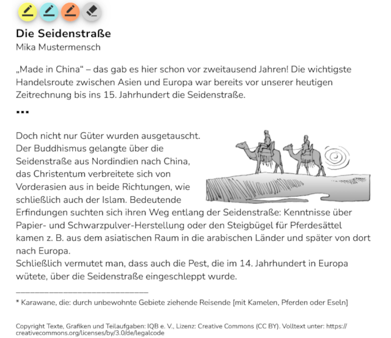](../../../tasks/design/basic/Stimulus/Text_ST_Assistent/index.llms.md)

Audiostimulus

Anleitung für den Audio Stimulus Assistenten

[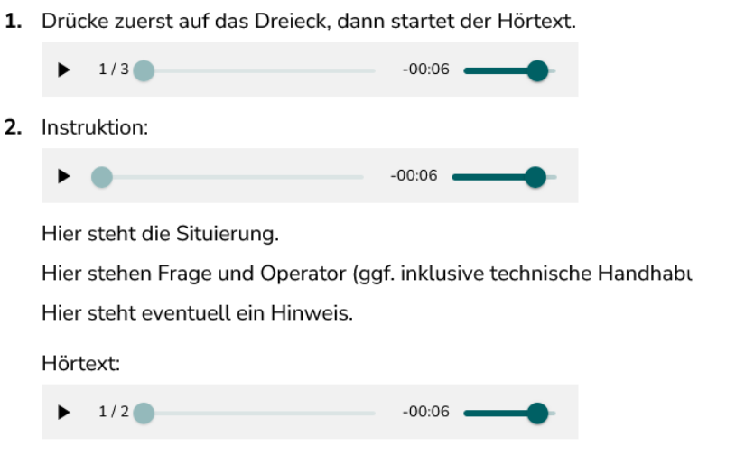](../../../tasks/design/basic/Stimulus/Audio_ST_Assistent/index.llms.md)

MC mit Text

Anleitung für den MC mit Text Assistenten

MC mit Bild

Anleitung für den MC mit Bild Assistenten

[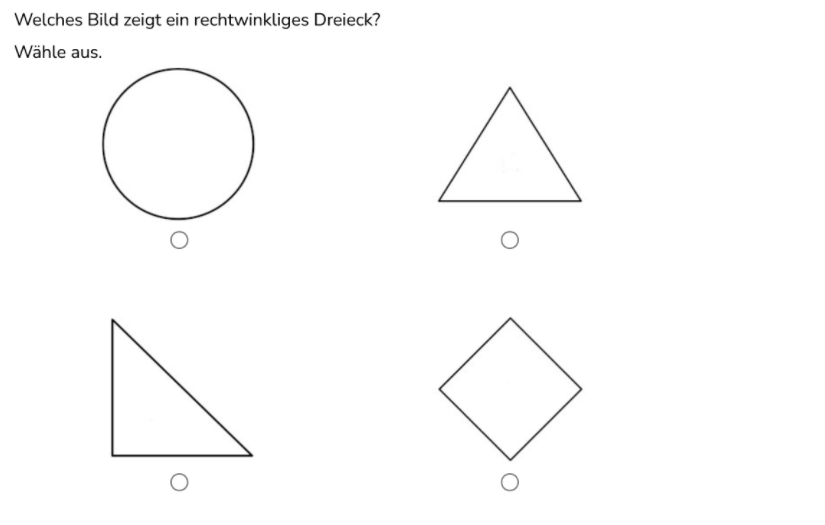](../../../tasks/design/basic/MC_Bild_Assistent/index.llms.md)

CMC (Complex Multiple Choice)

Anleitung für den CMC Assistenten

[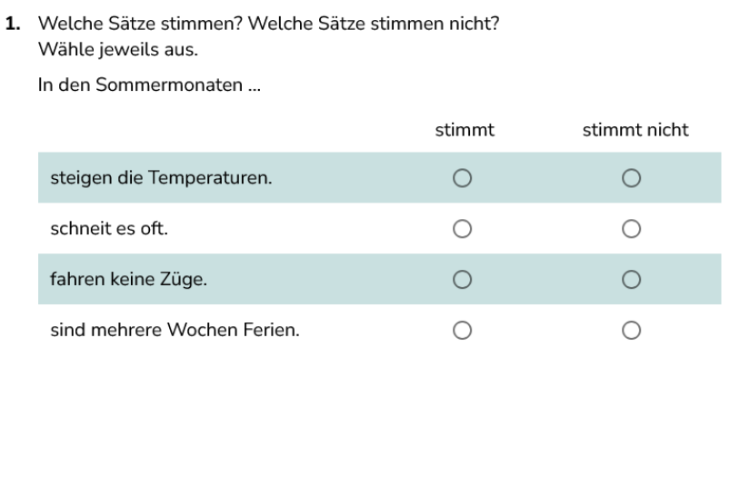](../../../tasks/design/basic/CMC-Assistent/index.llms.md)

Antwortfelder

Anleitung für den Antwortfelder Assistenten (Eingabefelder und Eingabebereiche)

[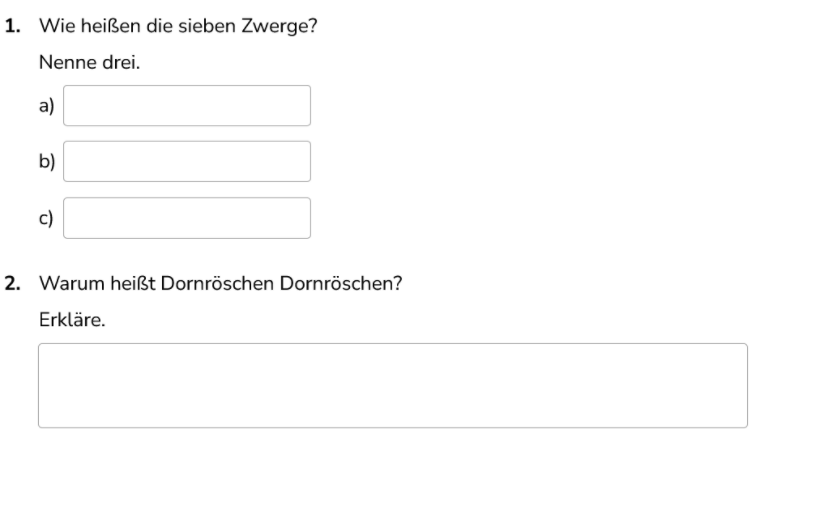](../../../tasks/design/basic/Antwortfelder_Assistent/index.llms.md)

Drag and Drop - Zuordnen

Anleitung für den Assistenten von Drag & Drop einseitig

[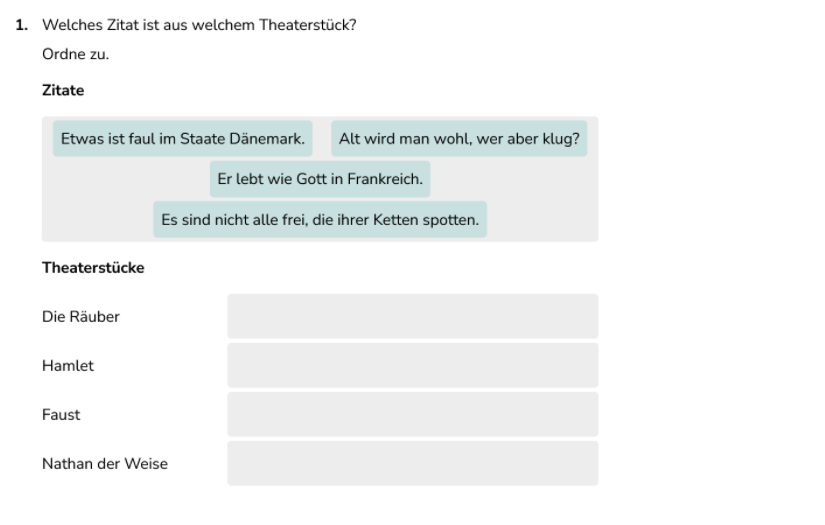](../../../tasks/design/basic/DaD/DaD_Assistent_Zuordnung/index.llms.md)

Drag and Drop - Zuordnen

Anleitung für den Assistenten von Drag & Drop zweiseitig

[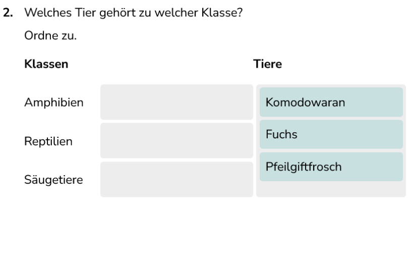](../../../tasks/design/basic/DaD/DaD_Assistent_Zuordnung_zweiseitig/index.llms.md)

Drag and Drop - Sortieren

Anleitung für den Drag and Drop Sortieren Assistenten einseitig

[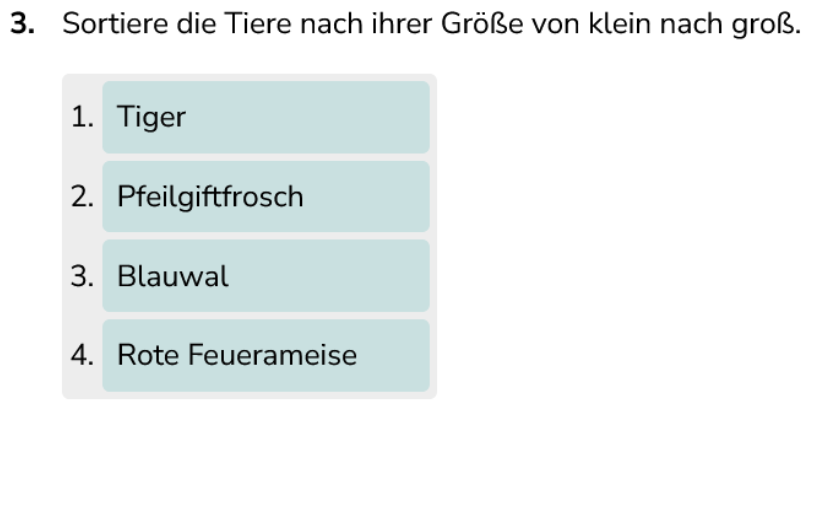](../../../tasks/design/basic/DaD/DaD_Assistent_Sortieren/index.llms.md)

Markieren

Anleitung für den Markieren Assistenten

[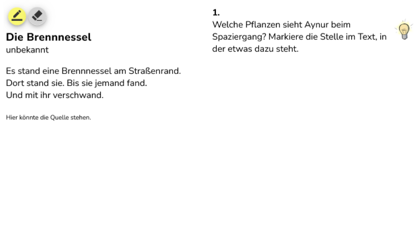](../../../tasks/design/basic/Markieren_Assistent/index.llms.md)

Rechenkästchen

Anleitung für den Rechenkästchen Assistenten

[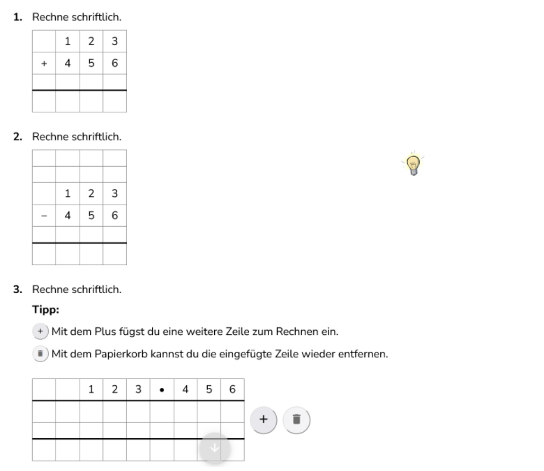](../../../tasks/design/basic/Rechenkastchen_Assistent/index.llms.md)

GeoGebra

Anleitung für den GeoGebra Assistenten

[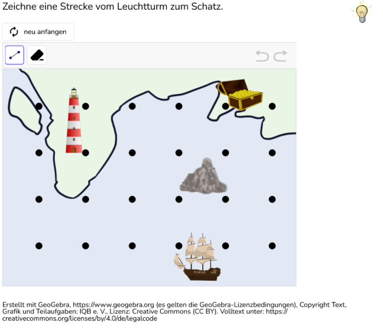](../../../tasks/design/basic/GGB_Assistent/index.llms.md)

Lückentext

Anleitung für das Verbundelement Lückentext

[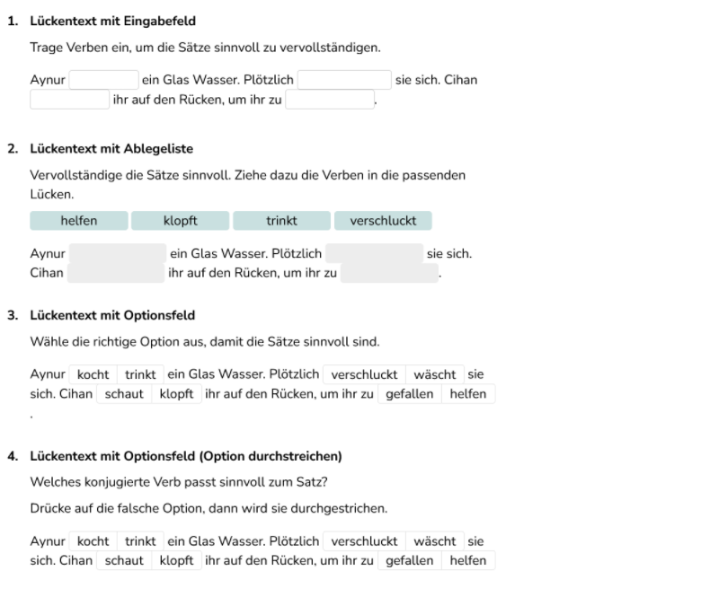](../../../tasks/design/basic/Lueckentext_Verbundelement/index.llms.md)

Tabelle

Anleitung für das Verbundelement Tabelle

[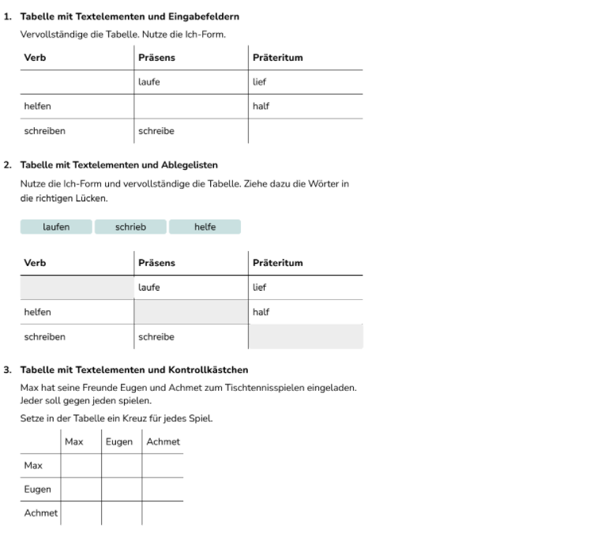](../../../tasks/design/basic/Tabellen_Verbundelement/index.llms.md)

Zurück nach oben
