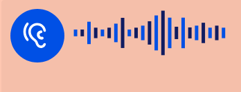

# StarS: Allgemeine Parameter

Der Player nimmt den gesamten verfügbaren Platz ein. Nichts wird gescrollt, sondern die Inhalte werden abgeschnitten, falls sie größer sind als der verfügbare Platz. Der Player wird versuchen, ggf. große Bilder auf die verfügbare Größe anzupassen.

Die Position von Elementen kann deshalb auch vertikal bestimmt werden. Das bedeutet, dass als Positionierung “unten” zur Verfügung steht. Das Layout im StarS-Bereich sieht meist vor, Elemente vertikal und horizontal zu zentrieren.

# `id` und `version`

Zu Beginn der Unitdefinition ist es erforderlich zu definieren, dass es sich um eine bestimmte Syntax handelt.

- `id` des Schemas mit dem konstanten Wert `stars-unit-definition`. Diese Angabe ist zwingend und sichert die korrekte Verarbeitung im Player.
- `version` des Schemas. Durch eine korrekte Angabe kann die Anpassung an neuere Schema-Versionen besser gelingen. Wird die Angabe weggelassen, wird die letzte veröffentlichte Version angenommen.

``` json
{
    "id": "stars-unit-definition",
    "version": "1.5",
    
}
```

# Hintergrundfarbe

Das Design des StarS-Players sieht eine Hintergrundfarbe vor. Alle anderen Farben sind darauf abgestimmt, dass eine relativ helle Farbe gesetzt wird. Ein weißer Hintergrund würde beispielsweise einen zu geringen Kontrast zu weißen Button-Flächen bedeuten. Daher ist als Standardfarbe ein helles Grau festgelegt. An keiner anderen Stelle der Unitdefinition kann eine Farbe gewählt werden.

Die Farbe wird über den Parameter `backgroundColor` festgelegt und betrifft die gesamte Player-Fläche. Zulässig sind die üblichen hexadezimalen Farbwerte mit einem Hash-Zeichen davor. Die in StarS üblichen Farbwerte:

 #FFE693   #FFD4AC   #FFC7B1   #FFD8F3   #E3D8FF   #E1E9FF   #B1DFFF   #BEF5FB   #DBFFAC   #ACFFB6 

 weiß \#FFFFFF   hellgrau \#EEEEEE 

Auf [dieser Seite](https://www.w3schools.com/colors/colors_picker.asp) finden Sie eine Online-Auswahl für Farben.

# Haupt-Audio

StarS-Aufgaben enthalten oft Audio-Sequenzen. Da die Kinder im unteren Primarbereich nur sehr wenig lesen können, werden sie über **Audio-Instruktionen** geleitet. Außerdem werden oft **Audio-Stimuli** präsentiert.

Links oben wird hierfür ein Symbol platziert, das einem Ohr gleicht. Ein automatisches Abspielen eines Audios beim Start/Betreten der Unit ist technisch nicht verlässlich zu implementieren. Daher muss die Testperson einen Button nutzen.


inaktiv



aktiv (Abspielen)

Ein Button wird für das Haupt-Audio eingeblendet, wenn in der Unitdefintion eine Audiosequenz gefunden wurde:

``` json
{
    "id": "stars-unit-definition",
    "version": "1.4",
    "mainAudio": {
        "audioSource": "data:audio/mpeg;base64,//OEZAAAAAAAAAwYA...", // <1>
        "firstClickLayer": true, // <2>
        "animateButton": false, // <3>
        "maxPlay": 0, // <4>
        "disableInteractionUntilComplete": false // <5>
    }
}
```

1.  `audioSource` enthält die Audio-Sequenz in base64-Kodierung
2.  Wenn `firstClickLayer` auf `true` gesetzt ist, dann wird beim ersten Aufruf eine unsichtbare Fläche über den gesamten Player gelegt. Wenn die Testperson dann irgendwo klickt, wird das als ein Klicken des Audio-Buttons gewertet. Der Layer wird dann sofort entfernt. Standardwert ist `false`, d. h. wenn die Unit-Definition diese Option nicht enthält, gibt es keinen Layer.
3.  Wenn `animateButton` auf `true` gesetzt ist, wird der Button nach einiger Zeit animiert (Wackeln). Darüber soll die Testperson auf den Button hingewiesen werden und dazu veranlasst werden, zu klicken. Der Standardwert ist `false`, d. h. wenn die Unit-Definition diese Option nicht enthält, gibt es keine Animation.
4.  Über `maxPlay` kann festgelegt werden, wie oft die Audio-Sequenz gehört werden darf. Für die Vergleichbarkeit der Testergebnisse kann es wichtig sein, diese Anzahl zu begrenzen. Bei Standardwert `0` gibt es keine Beschränkung.
5.  Wenn `true`, dann kann man während der Audio-Laufzeit keine Interaktionen auslösen.

# Weiter-Button

Rechts unten wird ein Button mit einem Pfeil eingeblendet, der zur nächsten Unit führt. Über den Parameter `continueButton` kann man diesen Button in der Anzeige steuern:

- `NO`: Der Button wird nie angezeigt.
- `ALWAYS`: Der Button wird unabhängig vom Status der Beantwortung angezeigt. Dies ist die Standardeinstellung, d. h. wenn man den Parameter `continueButton` weglässt, wird der Button stets angezeigt.
- `ON_MAIN_AUDIO_COMPLETE`/`ON_VIDEO_COMPLETE`: Der Button wird erst angezeigt, wenn das Haupt-Audio bzw. das Video einer Interaktion `VIDEO` vollständig abgespielt wurde. Sollte es kein Haupt-Audio geben, wird der Standardwert `ALWAYS` gesetzt.
- `ON_ANY_RESPONSE`: Der Button wird erst angezeigt, wenn irgendeine Interaktionsvariable einen gültigen Wert bekommen hat.
- `ON_FULL_CREDIT`: Der Button wird erst angezeigt, wenn für alle erwarteten Variablen die richtige Lösung gewählt wurde (verwendet z. B. in Übungsaufgaben)

> **NOTE:**
>
> Das Verhalten und die Anzeige des Weiter-Buttons wird ggf. auch durch den Abschnitt [Übungsaufgaben/Rückmeldung](../../../tasks/design/stars/feedback.llms.md) beeinflusst.

# Flatterband

Ist der Parameter `ribbonBars` auf `true` gesetzt, werden oben und unten gestreifte Bänder dargestellt. Dies soll den Aufgabenmodus “Übungsaufgabe” signalisieren. Dann wissen die Kinder, dass diese Aufgabe der Instruktion bzw. dem Üben der Beantwortung dient und noch keine Bewertung der Antwwort erfolgt.

# Vorgelagertes Kurzzeit-Bild

Nach einem ggf. definierten Haupt-Audio kann ein Bild für eine kurze Zeit eingeblendet werden. Dieses in der Didaktik als “Blitzsehen” bekannte Testformat liegt vor der eigentlichen Interaktion. Folgende Parameter sind möglich:

``` json
{
    "openingImage": {
        "imageSource": "data:image/jpeg;base64,//OEZAAAAAAAAAwYA...", // <1>
        "presentationDurationMS": 1500, // <2>
        "audioSource": "data:audio/mpeg;base64,//OEZAAAAAAAAAwYA..." // <3>
    }
}
```

1.  `imageSource` enthält das Bild in base64-Kodierung
2.  `presentationDurationMS` legt die Dauer der Anzeige fest.
3.  Wenn eine `audioSource` festgelegt wurde, dann wird unmittelbar nach der Anzeige des Bildes dieses Audio gespielt. Die nachfolgende Interaktion wird während des Audios noch blockiert, d. h. erst nach Ablauf gilt das vorgelagerte Bild als abgeschlossen.

Zurück nach oben
