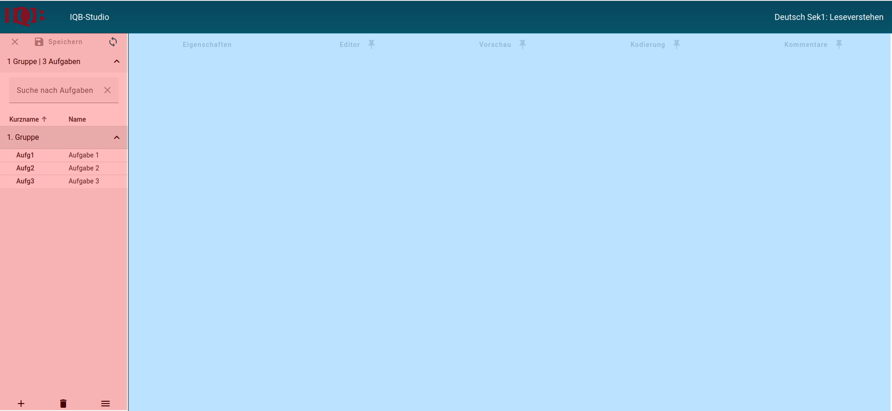

# Aufgaben entwickeln mit dem IQB-Studio

> **NOTE:**
>
> Benötigen Sie Hilfe bei der Aufgabenentwicklung oder generell zum Umgang mit dem IQB-Studio? Schreiben Sie uns gerne eine Mail <iqb-tba-info@lists.hu-berlin.de>.

Dieser Abschnitt fokussiert auf die Entwicklung von Aufgaben.

- [Organisieren](../tasks/manage/index.llms.md) ist vorrangig für die Rolle der Leitung eines Entwicklungsteams gedacht, die für eine effiziente Aufgabenentwicklung sorgen soll.
- [Aufgaben gestalten](../tasks/design/index.llms.md) enthält Anleitungen für Aufgabenentwickler\*innen, die den Umgang mit dem Editor lernen.
- [Kodierschema](../tasks/coding-scheme/index.llms.md) zeigt, wie man Regeln und Instruktionen für das Kodieren der Antworten einer Testung verfasst.

Nach der Anmeldung ist die Hauptansicht der **Arbeitsbereich**. Hier werden die meisten Einstellungen für die Aufgaben getroffen.

Ansicht Arbeitsbereich

**Links** – rot markiert – befindet sich die Aufgabenliste mit allen Aufgaben.

Die Aufgaben können bei Bedarf gruppiert werden. Im Bild befinden sich bspw. alle Aufgaben in einer Gruppe mit dem Namen: „1. Gruppe“. Im linken unteren Bereich befinden sich Schalter:

- Funktion “Aufgabe hinzufügen”
- Funktion “Aufgabe löschen”
- Hauptmenü des Arbeitsbereiches mit weiteren übergreifenden Funktionen

Man muss links eine Aufgabe in der Liste auswählen und kann diese dann im rechten Bildschirmbereich detailliert anschauen und bearbeiten.

**Rechts** – blau markiert – befinden sich Funktionen, die sich auf die gewählte Aufgabe beziehen. Die Funktionen sind über Reiter erreichbar:

- **Eigenschaften**: Eigenschaften, Items und Metadaten
- **Editor**: Bearbeitung der Elemente einer Aufgabe
- **Vorschau**: Anzeige der Aufgabe so, wie sie die Testperson sehen würde
- **Kodierung**: Eingabe von Regeln für das automatische Kodieren der Antworten und von Instruktionen für das manuelle Kodieren
- **Kommentare**: Lesen und Hinzufügen von Kommentaren

Mit Klick auf das Pin-Symbol  fixiert man diesen Reiter. Dann können zwei Reiter gleichzeitig angezeigt werden.

Zurück nach oben
