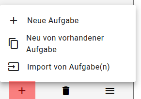

# Verschieben und Kopieren

# Vorlagen benutzen

Eine sinnvolle Arbeitsweise zu Beginn einer Aufgabenentwicklung kann es sein, bereits fertige Aufgaben zu kopieren. Das Konzept der “Vorlage” sieht eine Sammlung typischer Aufgabenformate vor, die nur Platzhalter als Bild oder Text enthalten (z. B. “Hier Option eintragen”). Für eine neue Aufgabe nimmt man dann eine passende Vorlage, kopiert sie in eine neue Aufgabe und ändert schrittweise die Platzhalter.

Im IQB-Studio kann man einen Arbeitsbereich anlegen, in dem nur Vorlagen gespeichert sind. Die Aufgabenentwickler\*innen haben in diesem Arbeitsbereich das Recht “Nur Kommentieren”, können also die Vorlagen nicht versehentlich ändern. Über die Funktion “Neu von vorhandener Aufgabe” im Ziel-Arbeitsbereich kann man dann eine neue Aufgabe aus einer Vorlage heraus anlegen.

# Aufgaben verschieben

Um im Verlauf der Entwicklung den Überblick zu behalten ist es manchmal nützlich, Aufgaben in andere Arbeitsbereiche zu verschieben. Im IQB-Studio ist hierfür eine Funktion verfügbar, wozu der “Vollzugriff” auf beide Arbeitsbereiche notwendig ist - auf die Quelle und auf das Ziel.

# Aufgaben abgeben und zurückgeben

Diese Funktion entspricht einer weiteren üblichen Arbeitsweise: Getrennte Gruppen erarbeiten Entwürfe, geben diese in den Review, erhalten Kommentare und teilweise Überarbeitungen, und aus dem Review heraus werden die Aufgaben final abgegeben. Die Herausforderung hier ist, dass die Zugriffsrechte von Quell- und Ziel-Arbeitsbereichen nicht übereinstimmen. Die Aufgaben werden also in einen Bereich verschoben, auf den man eigentlich keinen Zugriff hat.

![](data:image/svg+xml;base64,PHN2ZyB3aWR0aD0iNDgwIiBoZWlnaHQ9IjQ4MCIgdmlld2JveD0iMC4wMCAwLjAwIDMzOC4yNiAxODguMDAiIHhtbG5zPSJodHRwOi8vd3d3LnczLm9yZy8yMDAwL3N2ZyIgeGxpbms9Imh0dHA6Ly93d3cudzMub3JnLzE5OTkveGxpbmsiIHN0eWxlPSI7IG1heC13aWR0aDogbm9uZTsgbWF4LWhlaWdodDogbm9uZSI+CjxnIGlkPSJncmFwaDAiIGNsYXNzPSJncmFwaCIgdHJhbnNmb3JtPSJzY2FsZSgxIDEpIHJvdGF0ZSgwKSB0cmFuc2xhdGUoNCAxODQpIj4KPHRpdGxlPkc8L3RpdGxlPgo8cG9seWdvbiBmaWxsPSJ3aGl0ZSIgc3Ryb2tlPSJ0cmFuc3BhcmVudCIgcG9pbnRzPSItNCw0IC00LC0xODQgMzM0LjI2LC0xODQgMzM0LjI2LDQgLTQsNCI+PC9wb2x5Z29uPgo8IS0tIEEgLS0+CjxnIGlkPSJub2RlMSIgY2xhc3M9Im5vZGUiPgo8dGl0bGU+QTwvdGl0bGU+CjxlbGxpcHNlIGZpbGw9Im5vbmUiIHN0cm9rZT0iYmxhY2siIGN4PSI3OC4xNCIgY3k9Ii0xNjIiIHJ4PSI3OC4yNyIgcnk9IjE4Ij48L2VsbGlwc2U+Cjx0ZXh0IHRleHQtYW5jaG9yPSJtaWRkbGUiIHg9Ijc4LjE0IiB5PSItMTU3LjgiIGZvbnQtZmFtaWx5PSJBcmlhbCIgZm9udC1zaXplPSIxNC4wMCI+RW50d8O8cmZlIExlc2VuPC90ZXh0Pgo8L2c+CjwhLS0gQyAtLT4KPGcgaWQ9Im5vZGUzIiBjbGFzcz0ibm9kZSI+Cjx0aXRsZT5DPC90aXRsZT4KPGVsbGlwc2UgZmlsbD0ibm9uZSIgc3Ryb2tlPSJibGFjayIgY3g9IjE2NS4xNCIgY3k9Ii05MCIgcng9IjQyLjkiIHJ5PSIxOCI+PC9lbGxpcHNlPgo8dGV4dCB0ZXh0LWFuY2hvcj0ibWlkZGxlIiB4PSIxNjUuMTQiIHk9Ii04NS44IiBmb250LWZhbWlseT0iQXJpYWwiIGZvbnQtc2l6ZT0iMTQuMDAiPlJldmlldzwvdGV4dD4KPC9nPgo8IS0tIEEmIzQ1OyZndDtDIC0tPgo8ZyBpZD0iZWRnZTEiIGNsYXNzPSJlZGdlIj4KPHRpdGxlPkEtJmd0O0M8L3RpdGxlPgo8cGF0aCBmaWxsPSJub25lIiBzdHJva2U9ImJsYWNrIiBkPSJNOTMuMzIsLTE0NC4wNUMxMDQuNTIsLTEzNC4yIDExOS45MiwtMTIxLjcyIDEzMy42NiwtMTExLjM0IiAvPgo8cG9seWdvbiBmaWxsPSJibGFjayIgc3Ryb2tlPSJibGFjayIgcG9pbnRzPSIxMzYsLTExMy45NyAxNDEuOTQsLTEwNS4xOSAxMzEuODMsLTEwOC4zNCAxMzYsLTExMy45NyI+PC9wb2x5Z29uPgo8L2c+CjwhLS0gQiAtLT4KPGcgaWQ9Im5vZGUyIiBjbGFzcz0ibm9kZSI+Cjx0aXRsZT5CPC90aXRsZT4KPGVsbGlwc2UgZmlsbD0ibm9uZSIgc3Ryb2tlPSJibGFjayIgY3g9IjI1Mi4xNCIgY3k9Ii0xNjIiIHJ4PSI3OC4yNCIgcnk9IjE4Ij48L2VsbGlwc2U+Cjx0ZXh0IHRleHQtYW5jaG9yPSJtaWRkbGUiIHg9IjI1Mi4xNCIgeT0iLTE1Ny44IiBmb250LWZhbWlseT0iQXJpYWwiIGZvbnQtc2l6ZT0iMTQuMDAiPkVudHfDvHJmZSBIw7ZyZW48L3RleHQ+CjwvZz4KPCEtLSBCJiM0NTsmZ3Q7QyAtLT4KPGcgaWQ9ImVkZ2U0IiBjbGFzcz0iZWRnZSI+Cjx0aXRsZT5CLSZndDtDPC90aXRsZT4KPHBhdGggZmlsbD0ibm9uZSIgc3Ryb2tlPSJibGFjayIgZD0iTTIyNi4xNiwtMTQ0Ljc2QzIxMy43MSwtMTM1LjU4IDE5OS4wNSwtMTIzLjk0IDE4Ny4xNSwtMTEzLjg0IiAvPgo8cG9seWdvbiBmaWxsPSJibGFjayIgc3Ryb2tlPSJibGFjayIgcG9pbnRzPSIxODkuMjcsLTExMS4wNCAxNzkuNDEsLTEwNy4xNSAxODQuNjksLTExNi4zNCAxODkuMjcsLTExMS4wNCI+PC9wb2x5Z29uPgo8L2c+CjwhLS0gQyYjNDU7Jmd0O0EgLS0+CjxnIGlkPSJlZGdlMyIgY2xhc3M9ImVkZ2UiPgo8dGl0bGU+Qy0mZ3Q7QTwvdGl0bGU+CjxwYXRoIGZpbGw9Im5vbmUiIHN0cm9rZT0iYmxhY2siIGQ9Ik0xNTAuODYsLTEwNy4xNUMxNDAuMjksLTExNi41IDEyNS42OCwtMTI4LjQgMTEyLjI2LC0xMzguNjQiIC8+Cjxwb2x5Z29uIGZpbGw9ImJsYWNrIiBzdHJva2U9ImJsYWNrIiBwb2ludHM9IjExMC4wMSwtMTM1Ljk2IDEwNC4xMSwtMTQ0Ljc2IDExNC4yMSwtMTQxLjU2IDExMC4wMSwtMTM1Ljk2Ij48L3BvbHlnb24+CjwvZz4KPCEtLSBDJiM0NTsmZ3Q7QiAtLT4KPGcgaWQ9ImVkZ2UyIiBjbGFzcz0iZWRnZSI+Cjx0aXRsZT5DLSZndDtCPC90aXRsZT4KPHBhdGggZmlsbD0ibm9uZSIgc3Ryb2tlPSJibGFjayIgZD0iTTE4OC4zMywtMTA1LjE5QzIwMSwtMTE0LjQxIDIxNi41LC0xMjYuNjUgMjI5LjEzLC0xMzcuMzIiIC8+Cjxwb2x5Z29uIGZpbGw9ImJsYWNrIiBzdHJva2U9ImJsYWNrIiBwb2ludHM9IjIyNy4wOSwtMTQwLjE4IDIzNi45NSwtMTQ0LjA1IDIzMS42NiwtMTM0Ljg4IDIyNy4wOSwtMTQwLjE4Ij48L3BvbHlnb24+CjwvZz4KPCEtLSBEIC0tPgo8ZyBpZD0ibm9kZTQiIGNsYXNzPSJub2RlIj4KPHRpdGxlPkQ8L3RpdGxlPgo8ZWxsaXBzZSBmaWxsPSJub25lIiBzdHJva2U9ImJsYWNrIiBjeD0iMTY1LjE0IiBjeT0iLTE4IiByeD0iNDQuMTYiIHJ5PSIxOCI+PC9lbGxpcHNlPgo8dGV4dCB0ZXh0LWFuY2hvcj0ibWlkZGxlIiB4PSIxNjUuMTQiIHk9Ii0xMy44IiBmb250LWZhbWlseT0iQXJpYWwiIGZvbnQtc2l6ZT0iMTQuMDAiPkFiZ2FiZTwvdGV4dD4KPC9nPgo8IS0tIEMmIzQ1OyZndDtEIC0tPgo8ZyBpZD0iZWRnZTUiIGNsYXNzPSJlZGdlIj4KPHRpdGxlPkMtJmd0O0Q8L3RpdGxlPgo8cGF0aCBmaWxsPSJub25lIiBzdHJva2U9ImJsYWNrIiBkPSJNMTY1LjE0LC03MS43QzE2NS4xNCwtNjMuOTggMTY1LjE0LC01NC43MSAxNjUuMTQsLTQ2LjExIiAvPgo8cG9seWdvbiBmaWxsPSJibGFjayIgc3Ryb2tlPSJibGFjayIgcG9pbnRzPSIxNjguNjQsLTQ2LjEgMTY1LjE0LC0zNi4xIDE2MS42NCwtNDYuMSAxNjguNjQsLTQ2LjEiPjwvcG9seWdvbj4KPC9nPgo8L2c+Cjwvc3ZnPg==)

Die Zugriffsrechte sollen dann so gesetzt sein, dass z. B. die Arbeitsgruppe Hören keine Aufgaben der Arbeitsgruppe Lesen sehen kann.

Im IQB-Studio ist dies implementiert:

- **Abgeben**: Im Hauptmenü des Arbeitsbereiches ist diese Funktion zu finden. Um sie zu aktivieren, muss in der Bereichsgruppe dem Arbeitsbereich ein Ziel-Arbeitsbereich zugewiesen sein (s. Bereichsgruppen-Admin Reiter Arbeitsbereiche).
- **Zurückgeben**: Wenn der aktuelle Arbeitsbereich Aufgaben enthält, die aus anderen Arbeitsbereichen abgegeben wurden, dann ist diese Funktion aktiviert. Das IQB-Studio kennt den Quell-Arbeitsbereich und gibt die Aufgabe korrekt zurück.

Zurück nach oben
